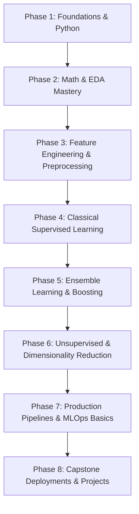

# 🚀 100 Days of Machine Learning — CampusX

<div align="center">

[](https://www.python.org/)
[](https://jupyter.org/)
[](https://scikit-learn.org/)
[](https://pandas.pydata.org/)
[](https://numpy.org/)
[](LICENSE)
[](https://www.youtube.com/c/CampusX-official)

<p align="center">
  <b>A disciplined, project-backed 100-day journey mastering Machine Learning from scratch to production-ready pipelines.</b>
  <br />
  Inspired and guided by <a href="https://www.youtube.com/c/CampusX-official"><b>Nitish Singh (CampusX)</b></a>.
</p>

[Roadmap](#-roadmap-overview) • [Curriculum Tracker](#-100-days-curriculum--progress-tracker) • [Projects](#-capstone--mini-projects) • [Repo Structure](#-repository-structure) • [Setup & Installation](#-quickstart--environment-setup) • [Connect](#-connect--socials)

---

</div>

## 📌 About The Challenge

The **#100DaysOfML** challenge is a commitment to spend focused, daily time understanding the intuition, mathematics, code implementation, and industry deployment of Machine Learning algorithms. 

This repository archives:
- 📓 **Jupyter Notebooks** with detailed code walkthroughs and markdown annotations.
- 📐 **Mathematical derivations** and hand-crafted intuition notes.
- 🧹 **Real-world feature engineering** pipelines using Scikit-Learn.
- 🛠️ **End-to-End deployed web applications** built with Streamlit / FastAPI.

---

## 🎯 Learning Objectives

- [x] Solidify core foundations in **Linear Algebra, Multivariable Calculus, and Statistics**.
- [x] Master **Data Analysis & Visualization** (NumPy, Pandas, Seaborn, Matplotlib, Plotly).
- [x] Build deep intuitive & mathematical understanding of **Supervised, Unsupervised, and Ensemble Learning**.
- [x] Master **Feature Engineering** (Imputation, Encoding, Scaling, Outlier Treatment, PCA).
- [x] Implement robust **Scikit-Learn Pipelines & ColumnTransformers**.
- [x] Deploy end-to-end Machine Learning systems to cloud platforms.

---

## 🗺️ Roadmap Overview



---

## 📅 100 Days Curriculum & Progress Tracker

> **Legend**: 
> - 🟢 **Completed**
> - 🟡 **In Progress**
> - ⚪ **Upcoming**

### 🧩 Phase 1: Python, Math & Data Manipulation (Days 1–15)

| Day | Topic / Milestone | Key Concepts Covered | Notebook / Code | Status |
|:---:|:---|:---|:---:|:---:|
| 01 | Introduction to Machine Learning | AI vs ML vs DL, Types of ML (Supervised, Unsupervised, Reinforcement) | [Day 01](notebooks/day-01/) | 🟢 |
| 02 | Machine Learning Development Lifecycle | Problem Framing, Data Collection, Cleaning, Modeling, Deployment | [Day 02](notebooks/day-02/) | 🟢 |
| 03 | NumPy Fundamentals | Arrays, Broadcasting, Vectorization, Indexing & Slicing | [Day 03](notebooks/day-03/) | 🟢 |
| 04 | Advanced NumPy Operations | Stacking, Splitting, Matrix Operations, Linear Algebra routines | [Day 04](notebooks/day-04/) | 🟢 |
| 05 | Pandas Basics | Series, DataFrames, File I/O, Indexing, Filtering | [Day 05](notebooks/day-05/) | 🟢 |
| 06 | Pandas Advanced Data Wrangling | GroupBy, Aggregations, Merging, Joining, Pivoting | [Day 06](notebooks/day-06/) | 🟢 |
| 07 | Exploratory Data Analysis (EDA) — Univariate | Histograms, KDE, Box Plots, Countplots, Skewness | [Day 07](notebooks/day-07/) | 🟢 |
| 08 | EDA — Bivariate & Multivariate Analysis | Scatter Plots, Pairplots, Heatmaps, Correlation Matrices | [Day 08](notebooks/day-08/) | 🟢 |
| 09 | Data Visualization with Seaborn & Matplotlib | Custom Styling, Subplots, Categorical & Distribution Plots | [Day 09](notebooks/day-09/) | 🟢 |
| 10 | Interactive Visualizations with Plotly | Interactive Charts, Choropleths, 3D Scatters | [Day 10](notebooks/day-10/) | 🟢 |
| 11 | Descriptive Statistics for ML | Mean, Median, Mode, Variance, Standard Deviation, IQR | [Day 11](notebooks/day-11/) | 🟢 |
| 12 | Probability Distributions | Normal, Binomial, Poisson, Central Limit Theorem (CLT) | [Day 12](notebooks/day-12/) | 🟢 |
| 13 | Hypothesis Testing | Z-Test, T-Test, ANOVA, Chi-Square Test, p-values | [Day 13](notebooks/day-13/) | 🟢 |
| 14 | Linear Algebra for ML | Vectors, Matrices, Dot Products, Eigenvalues & Eigenvectors | [Day 14](notebooks/day-14/) | 🟢 |
| 15 | Calculus Essentials for ML | Derivatives, Partial Derivatives, Gradients, Chain Rule | [Day 15](notebooks/day-15/) | 🟢 |

---

### 🧪 Phase 2: Feature Engineering & Preprocessing (Days 16–30)

| Day | Topic / Milestone | Key Concepts Covered | Notebook / Code | Status |
|:---:|:---|:---|:---:|:---:|
| 16 | Missing Value Imputation (Univariate) | Mean/Median/Mode Imputation, Arbitrary, End of Distribution | [Day 16](notebooks/day-16/) | 🟢 |
| 17 | Multivariate Missing Value Imputation | KNNImputer, IterativeImputer (MICE) | [Day 17](notebooks/day-17/) | 🟢 |
| 18 | Handling Categorical Variables — Nominal | One-Hot Encoding, Dummy Variable Trap, Frequent Categories | [Day 18](notebooks/day-18/) | 🟢 |
| 19 | Handling Categorical Variables — Ordinal | Ordinal Encoding, Label Encoding, Target Guided Encoding | [Day 19](notebooks/day-19/) | 🟢 |
| 20 | Outlier Detection & Treatment | Z-Score, IQR Proximity Rule, Percentile Capping, Trimming | [Day 20](notebooks/day-20/) | 🟢 |
| 21 | Feature Scaling Techniques | Standardization (StandardScaler), Normalization (MinMaxScaler), RobustScaler | [Day 21](notebooks/day-21/) | 🟢 |
| 22 | Mathematical Transformations | Log Transform, Reciprocal, Square Root, Box-Cox, Yeo-Johnson | [Day 22](notebooks/day-22/) | 🟢 |
| 23 | Feature Construction & Splitting | Extracting Date-Time, String Splitting, Binning/Discretization | [Day 23](notebooks/day-23/) | 🟢 |
| 24 | Handling Imbalanced Datasets | SMOTE, Random Oversampling, Undersampling, Class Weights | [Day 24](notebooks/day-24/) | 🟢 |
| 25 | Scikit-Learn ColumnTransformer | Heterogeneous column pipelines, preprocessing automation | [Day 25](notebooks/day-25/) | 🟢 |
| 26 | Scikit-Learn Pipelines | Chaining Imputation, Scaling, and Estimators cleanly | [Day 26](notebooks/day-26/) | 🟢 |
| 27 | Feature Selection — Filter Methods | VarianceThreshold, Chi2, ANOVA F-value, Mutual Information | [Day 27](notebooks/day-27/) | 🟢 |
| 28 | Feature Selection — Wrapper & Embedded | RFE, Forward/Backward Selection, Lasso/L1 regularization | [Day 28](notebooks/day-28/) | 🟢 |
| 29 | Principal Component Analysis (PCA) — Math & Code | Covariance Matrix, Eigendecomposition, Dimensionality Reduction | [Day 29](notebooks/day-29/) | 🟢 |
| 30 | Linear Discriminant Analysis (LDA) & t-SNE | Supervised vs Unsupervised Dimensionality Reduction | [Day 30](notebooks/day-30/) | 🟢 |

---

### 📈 Phase 3: Supervised Learning — Regression & Classification (Days 31–55)

| Day | Topic / Milestone | Key Concepts Covered | Notebook / Code | Status |
|:---:|:---|:---|:---:|:---:|
| 31 | Simple Linear Regression | Ordinary Least Squares (OLS), Closed-form solution derivation | [Day 31](notebooks/day-31/) | 🟢 |
| 32 | Gradient Descent from Scratch | Batch, Stochastic (SGD), and Mini-Batch Gradient Descent | [Day 32](notebooks/day-32/) | 🟢 |
| 33 | Multiple Linear Regression | Matrix Formulation, Vectorized Gradient Descent | [Day 33](notebooks/day-33/) | 🟢 |
| 34 | Polynomial Regression | Underfitting vs Overfitting, Bias-Variance Tradeoff | [Day 34](notebooks/day-34/) | 🟢 |
| 35 | Regularization: Ridge Regression (L2) | Loss formulation, shrinkage penalty, Geometric intuition | [Day 35](notebooks/day-35/) | 🟢 |
| 36 | Regularization: Lasso (L1) & ElasticNet | Sparsity generation, Feature selection intuition | [Day 36](notebooks/day-36/) | 🟢 |
| 37 | Regression Evaluation Metrics | MSE, RMSE, MAE, R², Adjusted R² | [Day 37](notebooks/day-37/) | 🟢 |
| 38 | Logistic Regression — Mathematical Intuition | Sigmoid function, Odds Ratio, Log-Odds, Maximum Likelihood | [Day 38](notebooks/day-38/) | 🟢 |
| 39 | Logistic Regression — Multiclass Classification | One-vs-Rest (OvR), One-vs-One (OvO), Softmax | [Day 39](notebooks/day-39/) | 🟢 |
| 40 | Classification Metrics — Part 1 | Confusion Matrix, Accuracy, Precision, Recall, F1-Score | [Day 40](notebooks/day-40/) | 🟢 |
| 41 | Classification Metrics — Part 2 | ROC Curve, AUC Score, PR Curve, Log Loss | [Day 41](notebooks/day-41/) | 🟢 |
| 42 | K-Nearest Neighbors (KNN) | Distance Metrics (Euclidean, Manhattan, Minkowski), Choosing K | [Day 42](notebooks/day-42/) | 🟢 |
| 43 | KNN Optimization & kd-Trees | Curse of Dimensionality, KD-Tree, Ball-Tree | [Day 43](notebooks/day-43/) | 🟢 |
| 44 | Naive Bayes Classifier | Bayes Theorem, Conditional Independence Assumption | [Day 44](notebooks/day-44/) | 🟢 |
| 45 | Gaussian, Multinomial & Bernoulli Naive Bayes | Text classification, Laplace Smoothing | [Day 45](notebooks/day-45/) | 🟢 |
| 46 | Support Vector Machines (SVM) — Hard & Soft Margin | Geometric Margin, Functional Margin, Slack variables ($C$) | [Day 46](notebooks/day-46/) | 🟢 |
| 47 | SVM Kernel Trick | Non-linear boundaries, RBF, Polynomial, Sigmoid Kernels | [Day 47](notebooks/day-47/) | 🟢 |
| 48 | Support Vector Regression (SVR) | $\epsilon$-tube, Slack variables for regression | [Day 48](notebooks/day-48/) | 🟢 |
| 49 | Decision Trees — Classification | Entropy, Information Gain, Gini Impurity, Splitting logic | [Day 49](notebooks/day-49/) | 🟢 |
| 50 | Decision Trees — Regression | Variance Reduction, Splitting on Continuous Targets | [Day 50](notebooks/day-50/) | 🟢 |
| 51 | Decision Tree Pruning | Pre-pruning (max_depth, min_samples) & Post-pruning (ccp_alpha) | [Day 51](notebooks/day-51/) | 🟢 |
| 52 | Hyperparameter Tuning | GridSearchCV vs RandomizedSearchCV vs Bayesian Optimization | [Day 52](notebooks/day-52/) | 🟢 |
| 53 | Cross-Validation Strategies | K-Fold, Stratified K-Fold, TimeSeriesSplit, Leave-One-Out | [Day 53](notebooks/day-53/) | 🟢 |
| 54 | Data Leakage & Best Practices | Train-test split discipline, Preprocessing fit/transform rules | [Day 54](notebooks/day-54/) | 🟢 |
| 55 | Benchmark Capstone: Traditional ML Models | Comparing Baseline Models on a Common Benchmark Dataset | [Day 55](notebooks/day-55/) | 🟢 |

---

### 🌲 Phase 4: Ensemble Learning & Boosting (Days 56–75)

| Day | Topic / Milestone | Key Concepts Covered | Notebook / Code | Status |
|:---:|:---|:---|:---:|:---:|
| 56 | Introduction to Ensemble Learning | Voting Classifier (Hard vs Soft), Diversity in Ensembles | [Day 56](notebooks/day-56/) | 🟢 |
| 57 | Bagging & Pasting | Bootstrap Aggregation, Out-of-Bag (OOB) Evaluation | [Day 57](notebooks/day-57/) | 🟢 |
| 58 | Random Forests — Architecture | Feature subsampling, Tree bagging, Feature importance | [Day 58](notebooks/day-58/) | 🟢 |
| 59 | Random Forest Hyperparameter Tuning | n_estimators, max_features, max_depth tuning strategies | [Day 59](notebooks/day-59/) | 🟢 |
| 60 | Extra Trees (Extremely Randomized Trees) | Faster training, threshold randomization | [Day 60](notebooks/day-60/) | 🟢 |
| 61 | Boosting Foundations & Intuition | Sequential learning, Bias reduction through weak learners | [Day 61](notebooks/day-61/) | 🟢 |
| 62 | AdaBoost — Step-by-Step Math | Sample weight updates, Learner weight ($\alpha$), Decision Stumps | [Day 62](notebooks/day-62/) | 🟢 |
| 63 | AdaBoost Implementation & Code | Scikit-Learn AdaBoostClassifier & AdaBoostRegressor | [Day 63](notebooks/day-63/) | 🟢 |
| 64 | Gradient Boosting Machine (GBM) Intuition | Residual learning, Pseudo-residuals, Learning rate ($\eta$) | [Day 64](notebooks/day-64/) | 🟢 |
| 65 | Gradient Boosting Mathematical Formulation | Taylor Series expansion, Loss function gradients | [Day 65](notebooks/day-65/) | 🟢 |
| 66 | XGBoost (Extreme Gradient Boosting) — Deep Dive | Regularized objective, Second-order Taylor approximation | [Day 66](notebooks/day-66/) | 🟢 |
| 67 | XGBoost Optimization Features | Approximate greedy algorithm, Sparsity awareness, Pruning | [Day 67](notebooks/day-67/) | 🟢 |
| 68 | LightGBM | Gradient-based One-Side Sampling (GOSS), EFB, Leaf-wise growth | [Day 68](notebooks/day-68/) | 🟢 |
| 69 | CatBoost | Categorical feature handling, Ordered boosting, Target encoding | [Day 69](notebooks/day-69/) | 🟢 |
| 70 | Stacking Classifier & Regressor | Meta-learners, Out-of-fold predictions | [Day 70](notebooks/day-70/) | 🟢 |
| 71 | Blending Models | Holdout validation blending vs K-Fold stacking | [Day 71](notebooks/day-71/) | 🟢 |
| 72 | Explainable AI (XAI) with SHAP | Shapley values, Feature importance, Force plots, Summary plots | [Day 72](notebooks/day-72/) | 🟢 |
| 73 | Model Interpretability with LIME | Local surrogate models, Interpretable decision boundaries | [Day 73](notebooks/day-73/) | 🟢 |
| 74 | Model Serialization | Pickle, Joblib, ONNX runtime conversion | [Day 74](notebooks/day-74/) | 🟢 |
| 75 | Project: End-to-End Ensemble Model | Production pipeline with XGBoost + Streamlit UI | [Day 75](notebooks/day-75/) | 🟢 |

---

### 🌐 Phase 5: Unsupervised Learning & Clustering (Days 76–85)

| Day | Topic / Milestone | Key Concepts Covered | Notebook / Code | Status |
|:---:|:---|:---|:---:|:---:|
| 76 | Clustering Foundations | Distance metrics, Centroids, Types of Clustering | [Day 76](notebooks/day-76/) | 🟢 |
| 77 | K-Means Clustering | Lloyd's Algorithm, Convergence, Objective Function (Inertia) | [Day 77](notebooks/day-77/) | 🟢 |
| 78 | K-Means++ & Evaluation | Optimal initialization, Elbow Method, Silhouette Analysis | [Day 78](notebooks/day-78/) | 🟢 |
| 79 | Hierarchical Clustering | Agglomerative vs Divisive, Dendrograms, Linkage Methods | [Day 79](notebooks/day-79/) | 🟢 |
| 80 | DBSCAN (Density-Based Clustering) | Core points, Border points, Noise, Epsilon ($\epsilon$), MinPts | [Day 80](notebooks/day-80/) | 🟢 |
| 81 | Gaussian Mixture Models (GMM) | Expectation-Maximization (EM) Algorithm, Soft clustering | [Day 81](notebooks/day-81/) | 🟢 |
| 82 | Anomaly Detection | Isolation Forest, One-Class SVM, Local Outlier Factor (LOF) | [Day 82](notebooks/day-82/) | 🟢 |
| 83 | Association Rule Learning | Market Basket Analysis, Apriori Algorithm, Support, Confidence, Lift | [Day 83](notebooks/day-83/) | 🟢 |
| 84 | Recommender Systems — Collaborative | User-based & Item-based Collaborative Filtering, Cosine Similarity | [Day 84](notebooks/day-84/) | 🟢 |
| 85 | Recommender Systems — Content & Hybrid | TF-IDF, Vector Embeddings, Matrix Factorization (SVD) | [Day 85](notebooks/day-85/) | 🟢 |

---

### 🚀 Phase 6: End-to-End Projects, MLOps & Production (Days 86–100)

| Day | Topic / Milestone | Key Concepts Covered | Notebook / Code | Status |
|:---:|:---|:---|:---:|:---:|
| 86 | Project Scaffolding & Cookiecutter | Production repo structure, config files, modular code design | [Day 86](notebooks/day-86/) | 🟢 |
| 87 | Building Custom Scikit-Learn Transformers | BaseEstimator, TransformerMixin, clean data pipeline creation | [Day 87](notebooks/day-87/) | 🟢 |
| 88 | Model Serving with FastAPI | REST API endpoints, Pydantic validation, Batch inference | [Day 88](notebooks/day-88/) | 🟢 |
| 89 | Frontend UI with Streamlit | Reactive widgets, charts, user inputs, API consumption | [Day 89](notebooks/day-89/) | 🟢 |
| 90 | Containerization with Docker | Dockerfile, image building, container networking, volumes | [Day 90](notebooks/day-90/) | 🟢 |
| 91 | Multi-Service Stacks with Docker Compose | Coordinating FastAPI backend + Streamlit dashboard | [Day 91](notebooks/day-91/) | 🟢 |
| 92 | Experiment Tracking with MLflow | Logging metrics, parameters, artifacts, model registry | [Day 92](notebooks/day-92/) | 🟢 |
| 93 | Data Version Control with DVC | Versioning large datasets, remote storage (S3/GCS/Drive) | [Day 93](notebooks/day-93/) | 🟢 |
| 94 | CI/CD for Machine Learning | GitHub Actions for linting (flake8/black) & automated pytest | [Day 94](notebooks/day-94/) | 🟢 |
| 95 | Model Monitoring & Data Drift | Concept Drift, Data Drift detection (Evidently AI) | [Day 95](notebooks/day-95/) | 🟢 |
| 96 | Cloud Deployment — Render / AWS EC2 | Deploying containerized ML API into production | [Day 96](notebooks/day-96/) | 🟢 |
| 97 | Capstone Project 1: Laptop Price Predictor | Advanced Feature Engineering, Pipelines, Streamlit deployment | [Day 97](projects/laptop-price-predictor/) | 🟢 |
| 98 | Capstone Project 2: Movie Recommendation System | Content-based filtering, Cosine Similarity, TMDB API | [Day 98](projects/movie-recommender/) | 🟢 |
| 99 | Capstone Project 3: Credit Risk / Fraud Detection | Imbalanced learning, Cost-sensitive tuning, Explainable AI | [Day 99](projects/fraud-detection-system/) | 🟢 |
| 100 | Reflection, Portfolio & Next Steps | Retrospective, Interview Prep, Transitioning to Deep Learning | [Day 100](notebooks/day-100/) | 🟢 |

---

## 🏆 Capstone & Mini Projects

Here are the flagship projects built during this 100-day journey:

| Project | Description | Tech Stack | Live Demo / Link |
|:---|:---|:---|:---:|
| 💻 **Laptop Price Predictor** | Predicts real-time laptop prices based on CPU, GPU, RAM, screen resolution, and brand. | `Scikit-Learn`, `Pandas`, `Streamlit` | [View Code](projects/laptop-price-predictor/) |
| 🎬 **Movie Recommender System** | Recommends top 5 movies based on content similarity with poster fetching via TMDB API. | `CountVectorizer`, `Cosine Similarity`, `Streamlit` | [View Code](projects/movie-recommender/) |
| 🛡️ **Fraud Detection Intelligence** | Real-time financial transaction anomaly and fraud detection engine with explainable AI. | `FastAPI`, `XGBoost`, `SHAP`, `Docker` | [View Code](projects/fraud-detection-system/) |
| 📱 **Customer Churn Predictor** | Predicts customer attrition for telecom services with feature importance breakdowns. | `LightGBM`, `SMOTE`, `FastAPI` | [View Code](projects/customer-churn/) |

---

## 📂 Repository Structure

```plaintext
100-days-of-machine-learning/
│
├── .github/
│   └── workflows/              # GitHub Actions CI/CD workflows
├── datasets/                   # Sample datasets used across exercises
│   └── raw/
├── notebooks/                  # Daily Jupyter Notebooks
│   ├── day-01-intro/
│   ├── day-02-lifecycle/
│   ├── ...
│   └── day-100-retrospective/
├── notes/                      # Markdown summaries, math notes & cheat sheets
│   ├── mathematics/
│   ├── algorithms/
│   └── interview-qa/
├── projects/                   # Standalone end-to-end applications
│   ├── laptop-price-predictor/
│   ├── movie-recommender/
│   └── fraud-detection-system/
├── requirements.txt            # Python dependencies
├── LICENSE                     # License information
└── README.md                   # Repository documentation
```

---

## ⚡ Quickstart & Environment Setup

Follow these steps to run any notebook or project locally:

### 1. Clone the repository
```bash
git clone https://github.com/your-username/100-days-of-machine-learning.git
cd 100-days-of-machine-learning
```

### 2. Create a virtual environment
```bash
# On macOS/Linux
python3 -m venv venv
source venv/bin/activate

# On Windows
python -m venv venv
venv\Scripts\activate
```

### 3. Install dependencies
```bash
pip install --upgrade pip
pip install -r requirements.txt
```

### 4. Launch Jupyter Notebook
```bash
jupyter lab
# or
jupyter notebook
```

---

## 💡 Key Takeaways & Cheat Sheets

<details>
<summary><b>🧠 1. Feature Engineering Rules of Thumb</b></summary>

- Always split data into **train and test sets BEFORE applying transformations** to prevent data leakage.
- Use `StandardScaler` when features follow a Gaussian distribution or when using distance/gradient-based models (KNN, SVM, Linear/Logistic Regression, Neural Nets).
- Use `RobustScaler` when your dataset contains significant outliers.
- Tree-based models (Decision Trees, Random Forest, XGBoost) are invariant to monotonic feature scaling.
</details>

<details>
<summary><b>⚖️ 2. Bias-Variance Tradeoff Summary</b></summary>

- **High Bias (Underfitting)**: Model is overly simplistic. Remedy: Add polynomial features, increase model complexity, decrease regularization ($\lambda$).
- **High Variance (Overfitting)**: Model memorizes training noise. Remedy: Gather more data, apply regularization (L1/L2), reduce tree depth, use ensemble bagging.
</details>

<details>
<summary><b>📊 3. Metric Selection Guide</b></summary>

- **Imbalanced Classification**: Avoid Accuracy. Focus on **Precision** (cost of False Positives is high, e.g., Spam detection), **Recall** (cost of False Negatives is high, e.g., Disease diagnosis), or **PR-AUC / ROC-AUC**.
- **Continuous Targets with Outliers**: Prefer **MAE** or **Huber Loss** over MSE/RMSE.
</details>

---

## 🙏 Acknowledgements & Credits

- Huge thanks to **[Nitish Singh](https://www.linkedin.com/in/nitish-singh-03412789/)** and the **[CampusX Community](https://www.youtube.com/c/CampusX-official)** for creating one of the most comprehensive and high-quality free Machine Learning curricula online.
- Check out the official [CampusX 100 Days of Machine Learning Playlist](https://www.youtube.com/playlist?list=PLKnIA16_Rmvbr7zKYQuBfsVkjoLujYZZ6).

---

## 🤝 Connect & Socials

Let's connect and talk about Machine Learning, Data Science, and AI!

[](https://linkedin.com/in/your-profile)
[](https://twitter.com/your-handle)
[](https://github.com/your-username)
[](https://yourportfolio.com)

---

<div align="center">
  <b>⭐ If you find this repository helpful, please consider starring it! ⭐</b>
</div>
